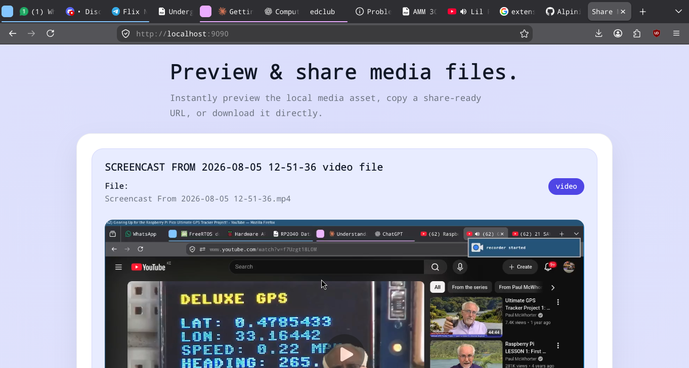
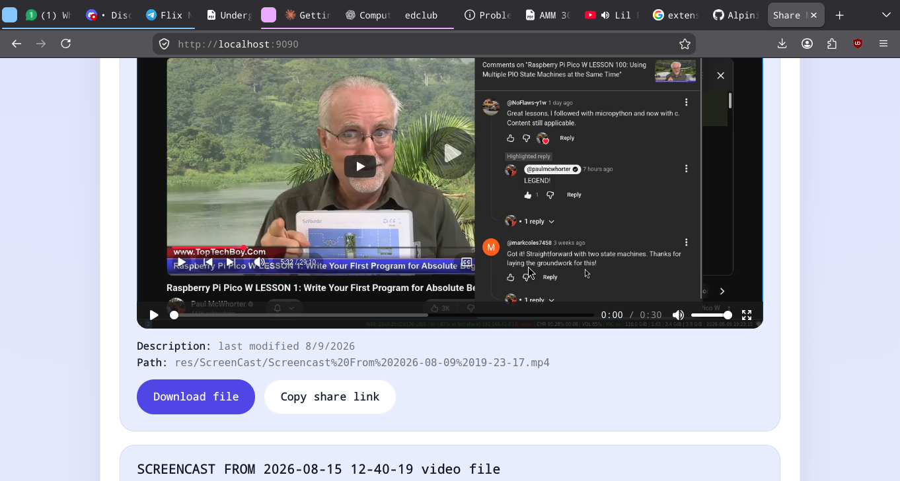
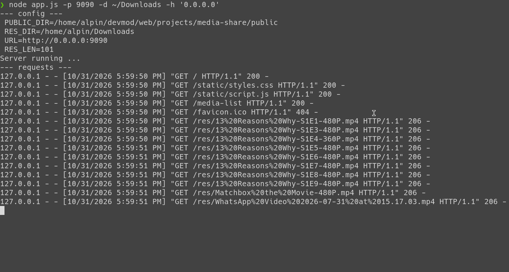

# Media Share

A tiny, dependency-free Node.js server that turns any folder into a browsable media page. Preview videos, audio, images, PDFs and text files in the browser, copy a share link, or download the file. Open it from any device on your network.



## Features

- **Zero dependencies.** Only Node's built-in modules.
- **Recursive scan.** Every file in the chosen folder and its subfolders is listed.
- **Inline previews**
  - Video and audio use the native player with seeking.
  - Images are shown inline and lazy-loaded.
  - PDFs and text-like files (`txt`, `md`, `json`, `csv`, `srt`, `vtt`, ...) load on click. Text previews fetch only the first 20 KB.
  - Anything else shows a download button.
- **Share and download.** One click copies an absolute URL or downloads the file.
- **HTTP Range support.** Responds with `206 Partial Content`, so browsers can seek in large videos and Safari plays media.
- **Safe path handling.** Requests are URL-decoded and checked so they cannot escape the served folder (`../` tricks return `403`).



## Requirements

- Node.js **18.3 or newer** (uses the built-in `util.parseArgs`).

## Quick start

```bash
git clone <your-repo-url> media-share
cd media-share

# serve a folder
node app.js -d ~/Videos

# then open http://127.0.0.1:8080
```

## Options

| Flag | Short | Env variable | Default | Description |
|------|-------|--------------|---------|-------------|
| `--dir` | `-d` | `RES_DIR` | `public/res` | Folder to scan and serve. A bare positional argument also works. |
| `--port` | `-p` | `PORT` | `8080` | Port to listen on. |
| `--host` | `-h` | n/a | `127.0.0.1` | Address to bind to. |

Priority is **CLI flag, then environment variable, then default**. Note that `-h` means `--host`, not help.

```bash
# positional directory
node app.js ~/Music

# flags
node app.js -p 9090 -d ~/Downloads

# environment variables
PORT=3000 RES_DIR=~/Pictures node app.js

# auto-restart while developing
node --watch app.js -d ~/Videos
```

## Sharing on your local network

By default the server only listens on `127.0.0.1`, so only your own machine can reach it. To let phones, TVs and other computers on the same network open it, bind to all interfaces:

```bash
node app.js -p 9090 -d ~/Downloads -h '0.0.0.0'
```



The startup banner shows the folder being served (`RES_DIR`), the URL, and how many files were found (`RES_LEN`). Each request is then logged in a common-log style, with `206` lines for ranged media requests.

Other devices can then visit `http://<your-computer-ip>:9090`. Find your IP with `ip addr` or `hostname -I`.

> **Warning:** there is no authentication. With `-h 0.0.0.0`, **everyone on the network can see and download every file in the served folder**, including hidden files and subfolders. Only serve folders you are happy to share, and avoid running it on public Wi-Fi.

## Project structure

```
media-share/
├── app.js                  # HTTP server, directory scanner, Range support
├── public/
│   ├── index.html          # page shell
│   └── static/
│       ├── script.js       # fetches /media-list, builds cards and previews
│       └── styles.css      # styling
├── docs/                   # README screenshots
└── .gitignore
```

## How it works

1. On startup `app.js` recursively scans the chosen folder and builds a list of files (label, name, URL, last-modified date).
2. The browser loads `index.html`, and `script.js` fetches that list from **`GET /media-list`**.
3. For each file, `script.js` picks a preview based on its extension and renders a card.
4. Files are streamed from **`/res/<path>`**. The server honours `Range` headers so seeking works.

### Routes

| Route | Serves |
|-------|--------|
| `/` | `public/index.html` |
| `/static/*` | CSS and JS from `public/` |
| `/media-list` | JSON: `{ "media": [ { label, name, src, description } ] }` |
| `/res/*` | Files from the served folder (with Range support) |

Only `GET` is accepted. Other methods return `405`.

## Limitations

- **The file list is built once at startup.** Restart the server to pick up new files.
- **Browser codec support varies.** `.mkv`, `.avi`, `.wmv` and some `.mov` files may not play inline. Download still works.
- **No thumbnails.** Large images are loaded at full size as you scroll.
- **No authentication or HTTPS.** Intended for trusted local networks.

## Ideas for next steps

- Re-scan on each `/media-list` request, or watch the folder with `fs.watch`.
- Search and filter by type.
- Skip hidden files and filter out unknown types.
- Server-side thumbnails (for example with `sharp`).
- Optional password or token for network sharing.

## Contributing

Issues and pull requests are welcome. Keep the project dependency-free where possible.

## License

MIT License

Copyright (c) 2026 alpinine

Permission is hereby granted, free of charge, to any person obtaining a copy
of this software and associated documentation files (the "Software"), to deal
in the Software without restriction, including without limitation the rights
to use, copy, modify, merge, publish, distribute, sublicense, and/or sell
copies of the Software, and to permit persons to whom the Software is
furnished to do so, subject to the following conditions:

The above copyright notice and this permission notice shall be included in all
copies or substantial portions of the Software.

THE SOFTWARE IS PROVIDED "AS IS", WITHOUT WARRANTY OF ANY KIND, EXPRESS OR
IMPLIED, INCLUDING BUT NOT LIMITED TO THE WARRANTIES OF MERCHANTABILITY,
FITNESS FOR A PARTICULAR PURPOSE AND NONINFRINGEMENT. IN NO EVENT SHALL THE
AUTHORS OR COPYRIGHT HOLDERS BE LIABLE FOR ANY CLAIM, DAMAGES OR OTHER
LIABILITY, WHETHER IN AN ACTION OF CONTRACT, TORT OR OTHERWISE, ARISING FROM,
OUT OF OR IN CONNECTION WITH THE SOFTWARE OR THE USE OR OTHER DEALINGS IN THE
SOFTWARE.

